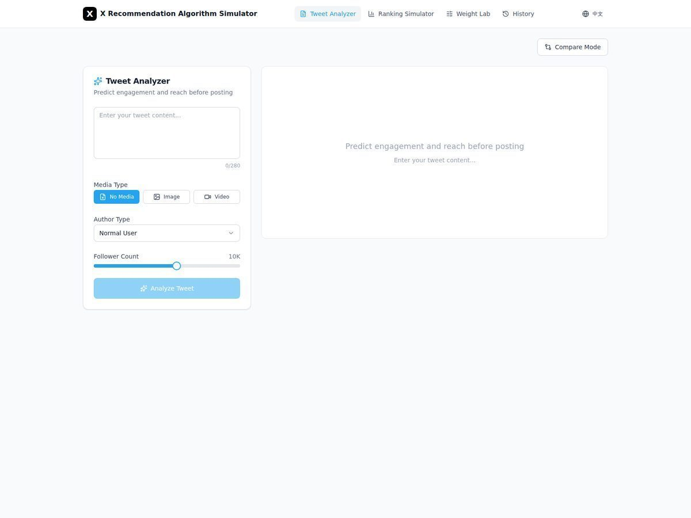
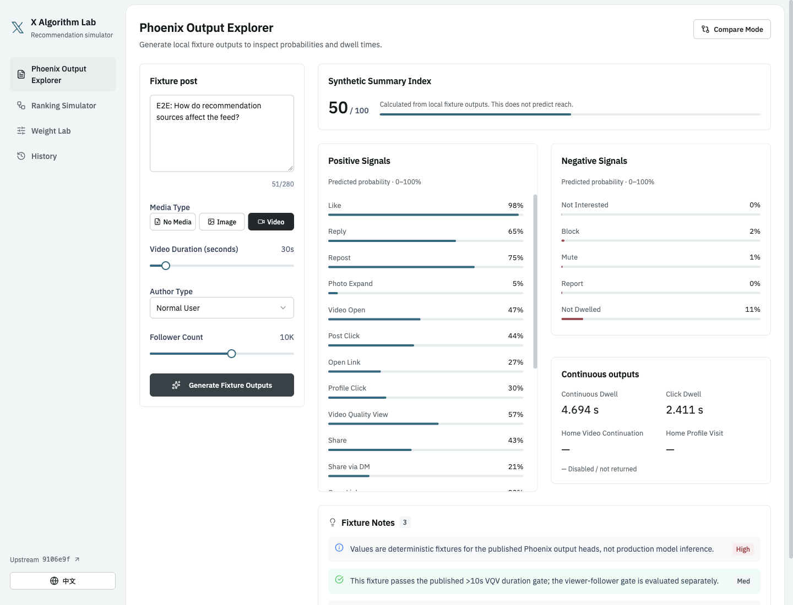
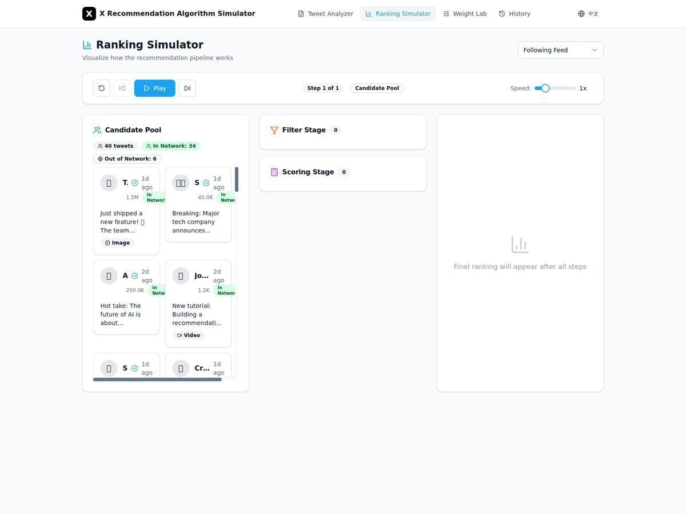
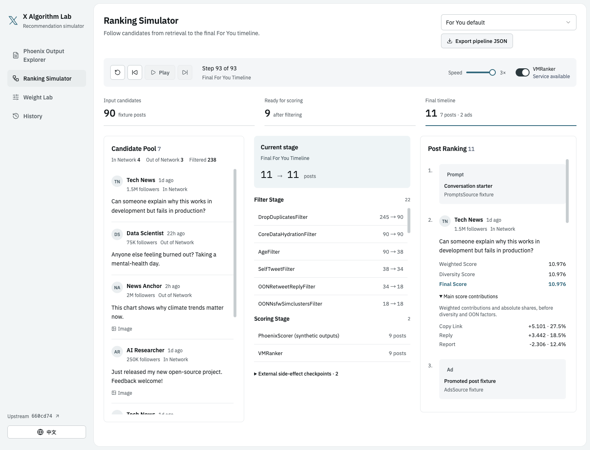

# X Algorithm Simulator

Interactive simulator for the public X recommendation pipeline.

Pinned to [`xai-org/x-algorithm@cec6168`](https://github.com/xai-org/x-algorithm/tree/cec61682937a4899360a340acba9e9b9bb8f43e3) · [简体中文](README.zh-CN.md)

## Overview

The simulator visualizes the published primary default path on deterministic local fixtures. It cannot predict production reach or engagement.

It covers the published source, filter, scoring, and ranking stages, plus fixture-only feed blending. It does not run model training or inference, remote retrieval and hydration services, production ad delivery, or notification filtering.

## Screenshots

Screenshots below come from the last full E2E run. More screenshots, the report, and traces are in [`artifacts/e2e`](artifacts/e2e).

| Page | Before | Current |
| --- | --- | --- |
| Output Explorer |  |  |
| Ranking Simulator |  |  |

## Features

- Step through source, filter, scoring, ranking, and feed-blending stages.
- Expand a ranked post to see up to three weighted contributions, each with an absolute share of at least 10%.
- Inspect 29 Phoenix output heads, ranking weights, filters, visibility, brand safety, and VMRanker DPP.
- Switch the UI between English and Chinese.

## Requirements

- Node.js `^20.19.0 || >=22.12.0` and npm, as required by Vite 7.
- ego lite and the `ego-browser` CLI for the end-to-end tests.

No environment variables, credentials, or external services are required.

## Quick Start

```bash
git clone https://github.com/lingengyuan/x-algorithm-simulator.git
cd x-algorithm-simulator
npm install
npm run dev
```

Open `http://localhost:5173`.

## Routes

| Path | Page |
| --- | --- |
| `/` | Output Explorer: 29 Phoenix output heads on local fixtures |
| `/simulator` | Ranking Simulator: pipeline walkthrough and final feed |
| `/weights` | Weight Lab: compare fixture outputs and tune weights |
| `/history` | Analysis history stored in the browser |

## Project Structure

| File | Contents |
| --- | --- |
| [`src/data/upstreamSnapshot.ts`](src/data/upstreamSnapshot.ts) | Pinned commit and published defaults |
| [`src/core/pipeline.ts`](src/core/pipeline.ts) | Source, filter, scoring, ranking, and feed-blending path |
| [`src/core/feed.ts`](src/core/feed.ts) | `slot_spread` ad blending, brand safety, and feed modules |
| [`scripts/e2e.mjs`](scripts/e2e.mjs) | End-to-end checks, screenshot capture, and trace export |

## Simulator Scope

- The default ad blender is `slot_spread`: it reserves spaced ad slots, fills each pair with the nearest compatible posts, and truncates the page.
- Brand-safety verdicts use the legacy path because `rust_home_mixer_ads_bs_v2_exp_enabled` is `false`.
- `post_video` and `grok_analyze` weights stay at `0.0`, and the video carousel and its CTR model are off.
- Home excursion heads (video continuation and profile visit) are returned with fusion weights `0.0`. VMRanker post-topic and recent-view inputs stay off because `rust_home_mixer_vm_ranker_send_post_topics` is `false`.
- The public repository omits `xai_post_text`, so local multilingual tokenization may differ from production.

## Development and Testing

Run ESLint, TypeScript, the production build, and the ego-browser E2E suite:

```bash
npm run check
```

The E2E runner starts a preview server on port `4173`. Results, screenshots, and compressed pipeline traces (`.json.gz`) go to `artifacts/e2e/`. Each trace records the input fixtures, the request context, and the weights.

Run the E2E suite alone with `npm run test:e2e`, or the DOM recovery scenario with `npm run test:dom-recovery`.

## Maintenance

Update the snapshot and implementation together, and pin upstream changes to a specific commit. Keep these behaviors when changing the pipeline:

- The default path reuses Home Mixer weighted scores in VMRanker.
- Topic requests skip DPP.
- Remote retrieval, embeddings, and Thompson draws use repeatable local fixtures.

Daily upstream checks run in the [`monitor-upstream`](.github/workflows/monitor-upstream.yml) workflow.

## License

[MIT](LICENSE)
