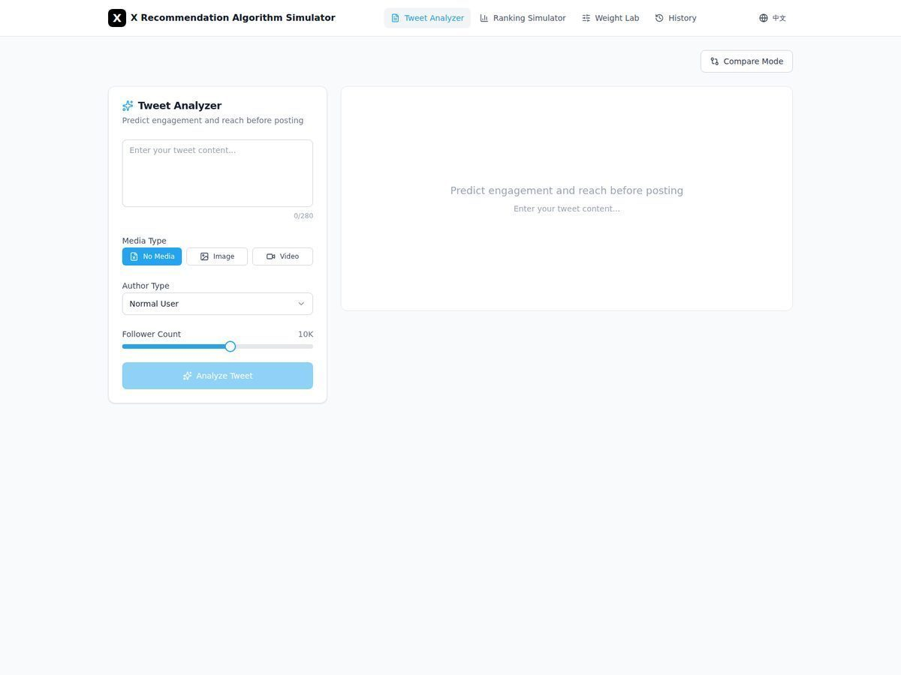
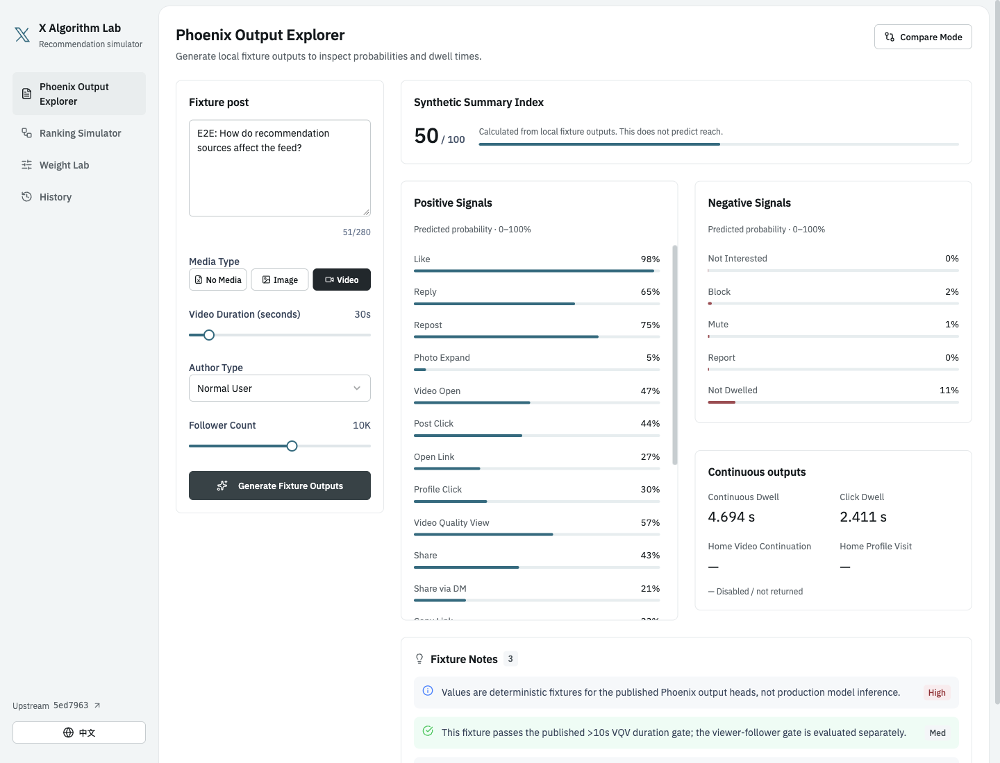
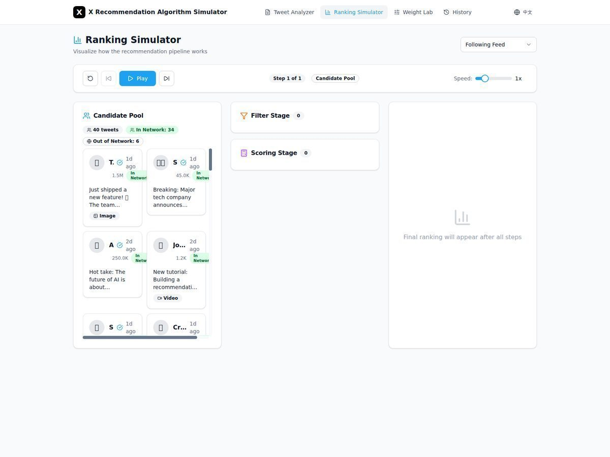
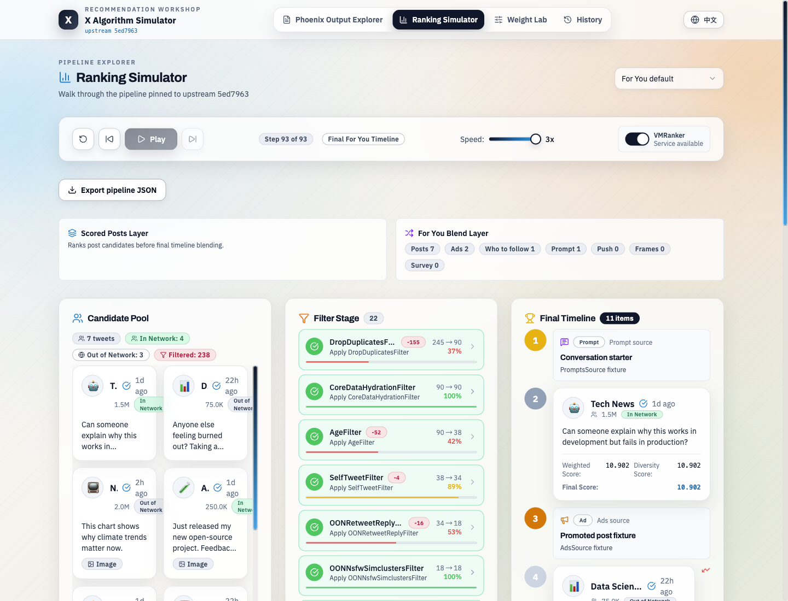

# X Algorithm Simulator

Interactive simulator for the public X recommendation pipeline.

用于理解 X 公开推荐流程的交互式模拟器。

Pinned to [`xai-org/x-algorithm@5ed7963`](https://github.com/xai-org/x-algorithm/tree/5ed796374ea48ee26058aab66ab10c266bea2bef) · [English](#english) · [简体中文](#简体中文)

## Interface Comparison / 界面对比

The current screenshots were regenerated from this version. / 当前截图由本版本重新生成。

<table>
  <tr>
    <th>Page / 页面</th>
    <th>Before / 之前</th>
    <th>Current / 当前</th>
  </tr>
  <tr>
    <td>Output Explorer<br>输出探索</td>
    <td></td>
    <td></td>
  </tr>
  <tr>
    <td>Ranking Simulator<br>排序模拟</td>
    <td></td>
    <td></td>
  </tr>
</table>

E2E screenshots and report: [`artifacts/e2e`](artifacts/e2e)

## English

### Project Description

Visualizes the public primary default path at upstream commit `5ed7963`. It uses deterministic local fixtures and cannot predict production reach or engagement.

### Features

- Step through the Scored Posts and For You pipelines.
- Explore 26 default Phoenix outputs and two optional excursion fields, ranking weights, filters, visibility, brand safety, and VMRanker DPP.
- Compare fixture outputs, tune weights, and keep local history in English or Chinese.

Production retrieval, models, social graph, safety services, and ads are not included. The public repository also omits `xai_post_text`, so local multilingual tokenization is not guaranteed to match production.

### Quick Start

Requires Node.js and npm.

```bash
git clone https://github.com/lingengyuan/x-algorithm-simulator.git
cd x-algorithm-simulator
npm install
npm run dev
```

### Skill Catalog

This is a web app, not a Codex skill package. Routes: `/`, `/simulator`, `/weights`, `/history`.

### Project Structure

Core references: [`upstreamSnapshot.ts`](src/data/upstreamSnapshot.ts), [`pipeline.ts`](src/core/pipeline.ts), and [`e2e.mjs`](scripts/e2e.mjs).

### Configuration

No environment variables, credentials, or external services are required.

### Development and Testing

```bash
npm run check
```

Runs ESLint, TypeScript, the production build, and ego-browser E2E tests. Requires ego lite and the ego-browser CLI. The E2E runner starts a preview server on port 4173. Results, screenshots, and compressed pipeline traces (`.json.gz`) are saved in `artifacts/e2e/`. Each trace includes the input fixtures, request context, and weights.

### Contributing

Pin upstream changes. Verify behavior through the browser E2E flow.

### Maintenance Guide

Update the snapshot and implementation together. Run `npm run check` at completion. The default path preserves Home Mixer weighted scores in VMRanker. Topic requests skip DPP. Remote retrieval, embeddings, and Thompson draws use repeatable local fixtures.

### Upstream Monitor

[Monitor X upstream](https://github.com/lingengyuan/x-algorithm-simulator/actions/workflows/monitor-upstream.yml) runs on GitHub Actions daily at 09:00 Beijing time. It reads the pinned commit from `src/data/upstreamSnapshot.ts`. A new upstream commit creates one Issue assigned to the repository owner. Closed Issues also prevent duplicate reminders. GitHub sends notifications according to your [notification settings](https://github.com/settings/notifications).

The Issue links to the diff and provides a request you can send to your development assistant. Adaptation starts only when you request it. No extra secrets are required. To check now, select **Run workflow**. Enable **verify_notifications** to create and close a test Issue. The run saves a JSON report as the `upstream-monitor-e2e` artifact.

GitHub can delay scheduled runs. In public repositories, GitHub disables schedules after 60 days without repository activity. Re-enable the workflow on its Actions page.

### License

[MIT](LICENSE)

## 简体中文

### 项目说明

可视化上游提交 `5ed7963` 公开的主默认路径。项目使用确定性本地测试数据，不能预测生产环境的真实曝光或互动。

### 功能特性

- 逐步查看 Scored Posts 和 For You 流程。
- 探索 26 个默认 Phoenix 输出及两个可选续看与主页停留字段、排序权重、过滤、可见性、品牌安全和 VMRanker DPP。
- 对比测试输出、实时调节权重，并保存中英文本地历史记录。

项目不包含生产召回、模型、社交图、安全服务和广告。公开仓库也没有 `xai_post_text`，因此本地多语言分词不保证与生产环境一致。

### 快速开始

需要 Node.js 和 npm。

```bash
git clone https://github.com/lingengyuan/x-algorithm-simulator.git
cd x-algorithm-simulator
npm install
npm run dev
```

### 技能目录

这是 Web 应用，不是 Codex Skill 包。页面入口为 `/`、`/simulator`、`/weights`、`/history`。

### 项目结构

核心文件：[`upstreamSnapshot.ts`](src/data/upstreamSnapshot.ts)、[`pipeline.ts`](src/core/pipeline.ts) 和 [`e2e.mjs`](scripts/e2e.mjs)。

### 配置

项目不需要环境变量、凭据或外部服务。

### 开发与测试

```bash
npm run check
```

该命令运行 ESLint、TypeScript、生产构建和 ego-browser 端到端测试。需要安装 ego lite 与 ego-browser CLI。测试脚本在 4173 端口启动预览服务。报告、截图和压缩流程记录（`.json.gz`）保存在 `artifacts/e2e/`。流程记录包含候选输入、请求上下文和权重。

### 贡献指南

固定上游提交。通过浏览器端到端流程验证行为。

### 维护指南

同步更新快照和实现。完成后运行 `npm run check`。默认路径在 VMRanker 中复用 Home Mixer 加权分。话题请求跳过 DPP。远程召回、向量和 Thompson 抽样使用可重复的本地测试数据。

### 上游监控

[Monitor X upstream](https://github.com/lingengyuan/x-algorithm-simulator/actions/workflows/monitor-upstream.yml) 每天北京时间 09:00 在 GitHub Actions 上运行。它从 `src/data/upstreamSnapshot.ts` 读取已适配的提交。有新上游提交时，它创建一条 Issue 并指派给仓库所有者。已关闭的 Issue 也参与去重。GitHub 按你的[通知设置](https://github.com/settings/notifications)发送提醒。

Issue 包含差异链接，以及可以发给开发助手的适配指令。你发出指令后才开始适配。监控不需要额外密钥。点击 **Run workflow** 可立即检查。勾选 **verify_notifications** 可创建并关闭测试 Issue。运行会将 JSON 报告保存为 `upstream-monitor-e2e` 工件。

GitHub 可能延迟定时运行。公开仓库连续 60 天无活动时，GitHub 会停用定时任务。可以在 Actions 页面重新启用。

### 许可证

[MIT](LICENSE)
