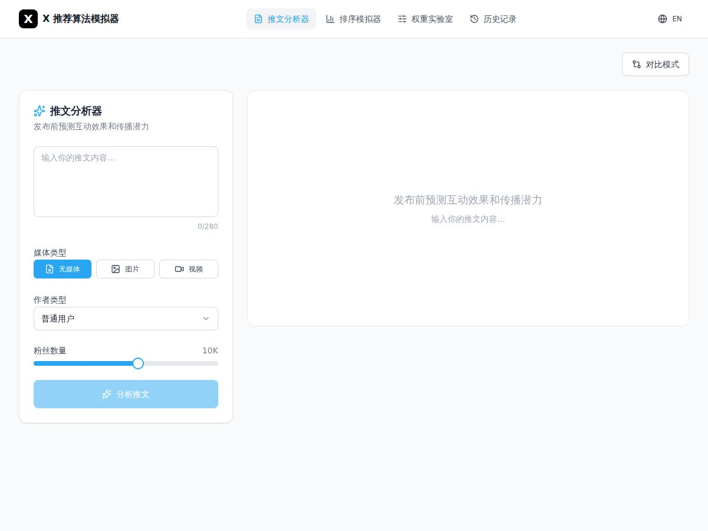
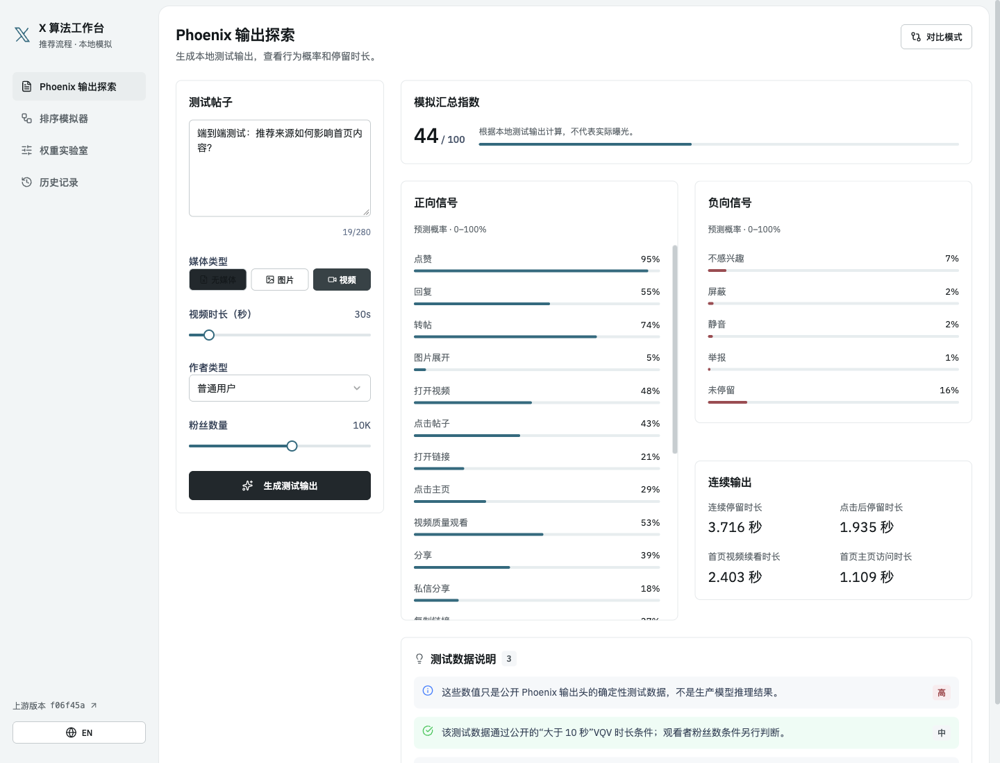
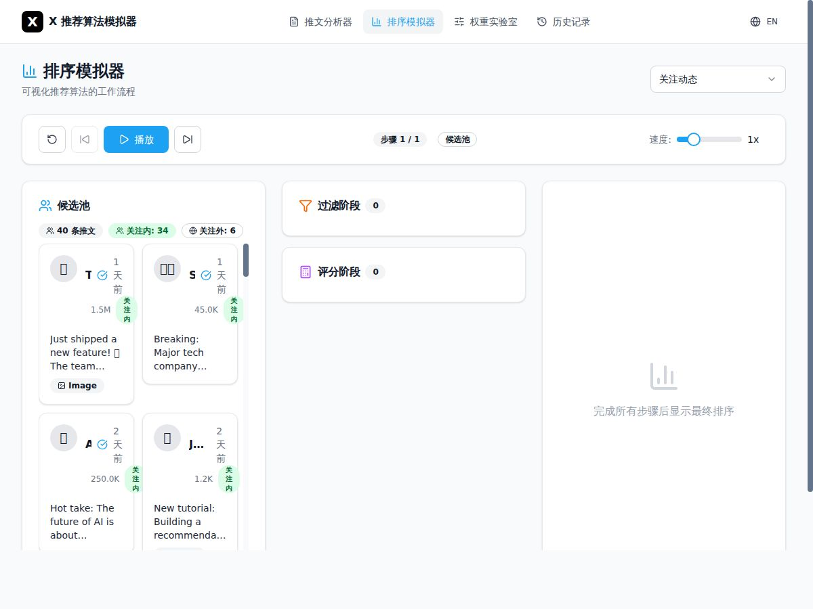
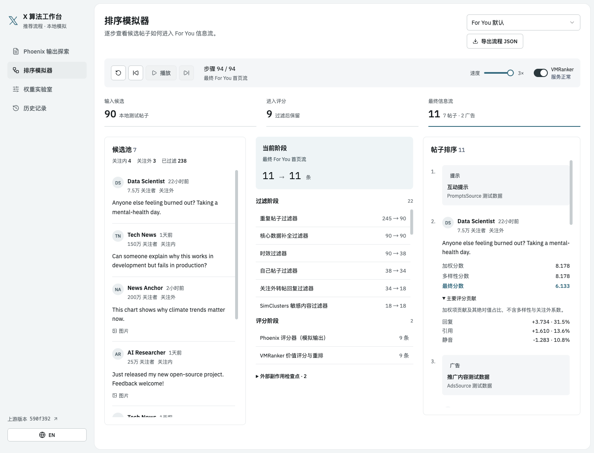

# X 算法模拟器

用于理解 X 公开推荐流程的交互式模拟器。

固定在 [`xai-org/x-algorithm@cec6168`](https://github.com/xai-org/x-algorithm/tree/cec61682937a4899360a340acba9e9b9bb8f43e3) · [English](README.md)

## 项目说明

项目可视化上游提交 `cec6168` 公开的主默认路径。所有计算基于确定性本地测试数据，不能预测生产环境的真实曝光或互动。

覆盖范围是公开的召回、过滤、评分、排序和本地数据混排路径。项目不运行模型训练与推理、远端召回与 hydration、生产广告投放和通知过滤。

## 界面对比

下表截图由本版本的端到端测试生成。

| 页面 | 之前 | 当前 |
| --- | --- | --- |
| 输出探索 |  |  |
| 排序模拟 |  |  |

更多截图和端到端报告见 [`artifacts/e2e`](artifacts/e2e)。

## 功能特性

- 逐步查看 Scored Posts 和 For You 流水线。
- 展开排序后的帖子，查看最多三项加权贡献，每项绝对值占比不低于 10%。
- 查看 29 个默认 Phoenix 输出权重，以及排序权重、过滤、可见性、品牌安全和 VMRanker DPP。
- 对比本地测试输出、实时调节权重，并保存中英文本地历史记录。

## 环境要求

- Node.js `^20.19.0 || >=22.12.0` 和 npm，这是 Vite 7 的要求。
- 端到端测试需要 ego lite 和 `ego-browser` CLI。

项目不需要环境变量、凭据或外部服务。

## 快速开始

```bash
git clone https://github.com/lingengyuan/x-algorithm-simulator.git
cd x-algorithm-simulator
npm install
npm run dev
```

## 页面入口

| 路径 | 页面 |
| --- | --- |
| `/` | 输出探索：在本地测试数据上查看 29 个 Phoenix 输出权重 |
| `/simulator` | 排序模拟：查看流水线各阶段和最终 feed |
| `/weights` | 权重实验室：对比测试输出并调节权重 |
| `/history` | 保存在浏览器中的分析历史 |

## 项目结构

| 文件 | 内容 |
| --- | --- |
| [`src/data/upstreamSnapshot.ts`](src/data/upstreamSnapshot.ts) | 固定的上游提交和默认参数 |
| [`src/core/pipeline.ts`](src/core/pipeline.ts) | 召回、过滤、评分和排序路径 |
| [`scripts/e2e.mjs`](scripts/e2e.mjs) | 端到端检查和截图采集 |

## 模拟范围

默认广告混排为 `slot_spread`：按请求间距预留广告位，为每个广告选取最近且兼容的上下邻帖，再按页容量截断。

固定版本中 `rust_home_mixer_ads_bs_v2_exp_enabled` 为 `false`，因此品牌安全判定使用 legacy 路径。

`post_video` 和 `grok_analyze` 权重保持 `0.0`，视频轮播在默认参数下关闭。首页停留字段会返回，融合权重保持 `0.0`。轮播 CTR 模型关闭；seen filter 和中等风险过滤在上游开启，但只在视频轮播启用时生效。

VMRanker 的帖子话题和最近浏览输入默认关闭，因为 `rust_home_mixer_vm_ranker_send_post_topics` 为 `false`。

公开仓库不含 `xai_post_text`，本地多语言分词不保证与生产环境一致。

## 开发与测试

```bash
npm run check
```

该命令依次运行 ESLint、TypeScript、生产构建和 ego-browser 端到端测试。测试脚本在 4173 端口启动预览服务。

报告、截图和压缩流程记录（`.json.gz`）写入 `artifacts/e2e/`。每条记录包含候选输入、请求上下文和权重。

只跑端到端测试用 `npm run test:e2e`，只跑 DOM 恢复场景用 `npm run test:dom-recovery`。

## 贡献指南

上游变更固定到具体提交。用浏览器端到端流程验证行为。

## 维护指南

快照和实现同步更新，完成后运行 `npm run check`。

修改流水线时保持以下行为：

- 默认路径在 VMRanker 中复用 Home Mixer 加权分。
- 话题请求跳过 DPP。
- 远端召回、向量和 Thompson 抽样使用可重复的本地测试数据。

## 上游监控

[Monitor X upstream](https://github.com/lingengyuan/x-algorithm-simulator/actions/workflows/monitor-upstream.yml) 每天北京时间 09:00 在 GitHub Actions 上运行，从 `src/data/upstreamSnapshot.ts` 读取固定的提交。

上游出现新提交时，工作流创建一条 Issue 并指派给仓库所有者。已关闭的 Issue 也参与去重。GitHub 按你的[通知设置](https://github.com/settings/notifications)发送提醒。

Issue 包含差异链接，以及可直接发给开发助手的适配指令。你发出指令后才开始适配。监控不需要额外密钥。

立即检查请点 **Run workflow**。勾选 **verify_notifications** 可创建并关闭一条测试 Issue。运行结果以 JSON 报告保存为 `upstream-monitor-e2e` 工件。

GitHub 可能延迟定时运行，并在公开仓库连续 60 天无活动后停用定时任务。可以在 Actions 页面重新启用。

## 许可证

[MIT](LICENSE)
